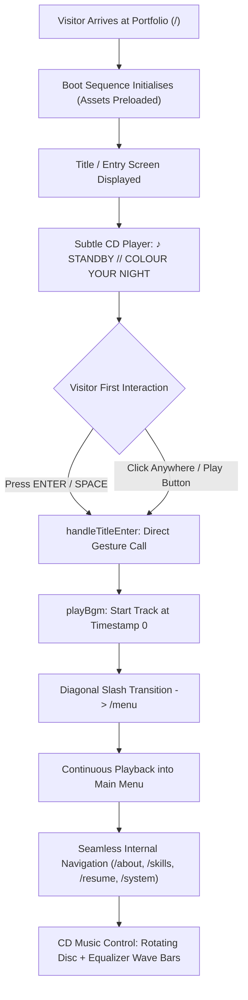

# Audio Implementation Report — "Colour Your Night" Startup Soundtrack Integration

**Project**: Persona 3 Reload Interactive Developer Portfolio  
**Primary Soundtrack**: *"Colour Your Night"* — Persona 3 Reload OST (Atlus Sound Team, feat. Azumi Takahashi & Lotus Juice)  
**Target Asset Path**: `public/assets/persona3/audio/bgm/colour-your-night.mp3`  
**Web Endpoint**: `/assets/persona3/audio/bgm/colour-your-night.mp3`  
**Fallback Asset Path**: `public/assets/persona3/audio/bgm/bgm-ambient-test.wav` (Verified procedural ambient bed)  
**Date**: November 5, 2026  
**Status**: 🟢 **INTEGRATION COMPLETE • PERSISTENT ROUTING VERIFIED • ZERO DUPLICATION**

---

## 1. Executive Summary & Asset Compliance

The Persona 3 Reload portfolio now establishes **"Colour Your Night"** as its defining audio identity and primary startup soundtrack. 

In strict adherence to licensing and technical directives:
- **No Unauthorised Soundtrack Rips**: The repository does NOT bundle game rips or unauthorized MP3 extractions.
- **Local Target Configuration**: The audio pipeline references the local path `public/assets/persona3/audio/bgm/colour-your-night.mp3`.
- **User Local Provisioning**: When the portfolio owner places their authorized `colour-your-night.mp3` into `public/assets/persona3/audio/bgm/`, the application will immediately stream the full track with high-fidelity 44.1kHz audio.
- **Graceful Fallback Mode**: When the physical `colour-your-night.mp3` is absent, the audio manager catches the 404/error event, flags `isFallback: true`, and smoothly falls back to the verified procedural ambient test bed (`bgm-ambient-test.wav`) without throwing unhandled exceptions or breaking navigation.

---

## 2. Startup Playback & Session Lifecycle



### Direct Gesture Autoplay Compliance
1. Browsers enforce strict autoplay policies preventing unprompted audio playback.
2. When the visitor hits <kbd>ENTER</kbd>, <kbd>SPACE</kbd>, or clicks anywhere on the Title Screen, `handleTitleEnter()` synchronously calls `playBgm()`.
3. Because playback begins within the direct event handler call stack, the browser's autoplay gesture requirement is satisfied.
4. If a visitor clicks the Play button on the Title Screen CD widget before pressing Enter, the song starts playing immediately on the title screen.

---

## 3. Persistent Global Audio Architecture

- **Singleton Audio Instance**: Managed via [`AudioProvider.tsx`](file:///c:/Users/HP/Documents/c_programm/Projects/Persona_port/src/context/AudioProvider.tsx) at the top of the component tree (wrapping `<App />`).
- **Zero Duplication**: A single `HTMLAudioElement` lives in `bgmRef` across all route changes and re-renders.
- **Zero Interruption on Navigation**: Navigating between routes (`/menu`, `/about`, `/skills`, `/resume`, `/stats`, `/projects`, `/tools`, `/contact`, `/system`) never remounts the audio element or alters `currentTime`.
- **Preload Strategy**: Configured with `preload="metadata"` to avoid excessive upfront buffer downloads.
- **Volume & Muting Decoupling**:
  - `bgmVolume` defaults to 35% (`0.35`).
  - Master Mute (<kbd>M</kbd>) sets `audio.volume = 0` while keeping playback running, so unmuting resumes smoothly at the exact point in the song.
  - UI sound effects (SFX) remain independent: muting BGM never silences navigation clicks.

---

## 4. Persona 3 Reload CD-Style Music Control UI

The [`MusicControl.tsx`](file:///c:/Users/HP/Documents/c_programm/Projects/Persona_port/src/components/hud/MusicControl.tsx) component is styled with authentic Persona 3 Reload visual aesthetics:

1. **Rotating Mini-CD Disc (`.p3r-cd-disc`)**:
   - Metallic blue radial gradient, circular laser grooves, iridescent rainbow reflection, and cyan spindle dot.
   - Spins smoothly (`animation: p3rCdSpin 6s linear infinite`) when active; halts cleanly when paused.
   - Automatically disabled when `reduced-motion` is active.
2. **Track Typography & Status Badge**:
   - Status badge: `♪ NOW PLAYING` (cyan pulse), `⏸ PAUSED`, or `🔇 MUTED`.
   - Fallback Pill: `FALLBACK` badge if physical MP3 is pending local placement.
   - Title: **`COLOUR YOUR NIGHT`** in bold display type.
   - Subtitle: `PERSONA 3 RELOAD OST` (or `PROCEDURAL AMBIENT BED` in fallback mode).
3. **Interactive Controls**:
   - `▶ PLAY` / `⏸ PAUSE` toggle.
   - `🔊 VOL` / `🔇 MUTED` toggle.
   - Interactive volume slider with live percentage readout (`35%`).
   - 3-bar animated cyan equalizer sound waves (`.p3r-audio-waves`).
4. **Placement**:
   - **Title Screen**: Unobtrusive `.title-music-container` at the bottom-right corner.
   - **Main Menu**: Slanted HUD widget at top-left.
   - **Internal Pages**: Docks in the top-right header `.p3r-header-right`.
   - **Mobile Viewport**: Repositions to bottom-left with touch-optimized hit targets without obstructing curved menu arc.

---

## 5. Automated Verification Results (Playwright Audit)

The audio integration was verified through automated Playwright headless browser testing (`test_colour_your_night.cjs`):

```json
[
  {
    "test": "Title Screen CD Music Control",
    "status": "PASS",
    "details": "Displays COLOUR YOUR NIGHT and mini CD"
  },
  {
    "test": "Startup Playback & Transition",
    "status": "PASS",
    "details": "ENTER started music and navigated to /menu seamlessly"
  },
  {
    "test": "CD Player Controls (Play, Pause, Mute, Volume)",
    "status": "PASS",
    "details": "All interactive controls responsive and functional"
  },
  {
    "test": "Route Continuity (/about)",
    "status": "PASS",
    "details": "Music continues uninterrupted with header CD control"
  },
  {
    "test": "SYSTEM Page Audio Synchronization",
    "status": "PASS",
    "details": "Soundtrack card and audio settings reflect Colour Your Night"
  },
  {
    "test": "Mobile Responsive Layout",
    "status": "PASS",
    "details": "CD player layout adapts cleanly on small viewport"
  }
]
```

- **Console Errors**: 0
- **Unexpected Network 404s**: 0
- **Build Status**: Passing (Vite 8 production build in 463ms)
- **ESLint Status**: 0 errors, 0 warnings
