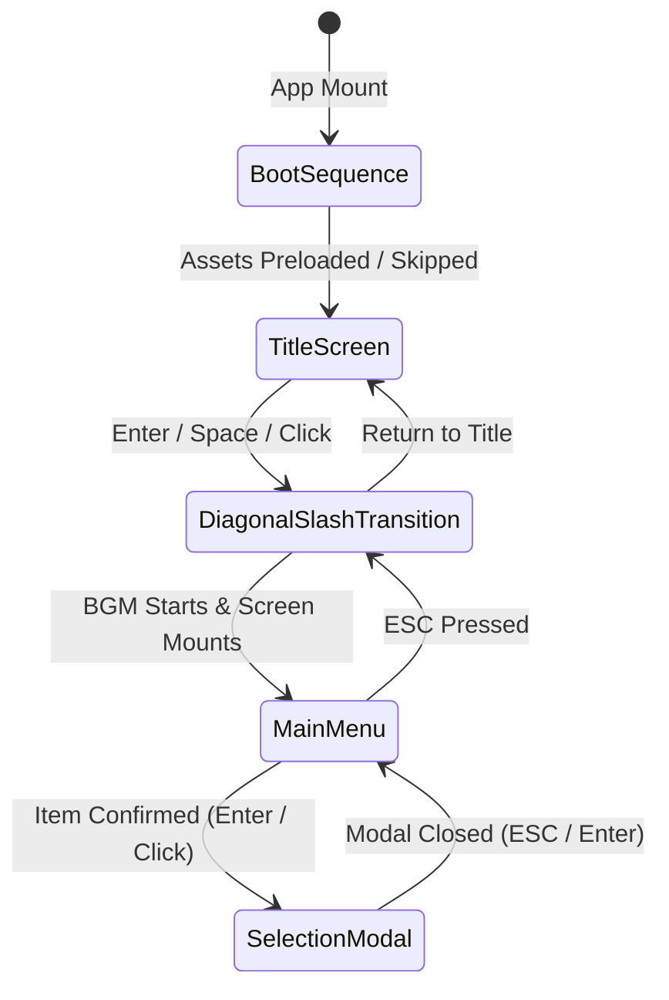

# Persona 3 Reload Portfolio — System Architecture

This document provides an in-depth breakdown of the engineering design, mathematical algorithms, state transitions, and component hierarchy powering the Persona 3 Reload portfolio experience.

---

## 1. Master Application State Machine

The top-level application ([`src/App.tsx`](file:///c:/Users/HP/Documents/c_programm/Projects/Persona_port/src/App.tsx)) is modeled as a deterministic state machine managing the user journey from initial boot to interactive menu navigation:



### State Definitions
1. **`boot` (`BootSequence.tsx`)**:
   - Executes asset preloading (`p3r-main-key-art.png`, `makoto-yuki.webp`, thumbnails).
   - Animates system initialization text logs.
   - Respects user skip triggers (<kbd>Space</kbd>, <kbd>Enter</kbd>, <kbd>Esc</kbd>).
2. **`title` (`TitleScreen.tsx`)**:
   - Renders 1080p full-screen presentation artwork with atmospheric vignette overlays.
   - Listens for the user's initial interaction gesture to satisfy browser autoplay restrictions.
3. **`menu` (`MainMenu.tsx`)**:
   - Full interactive game UI hosting the curved arc navigation, dynamic character backdrop, profile HUD, context panels, and audio controls.

---

## 2. Curved Arc Navigation Mathematics

The menu items do not follow a flat CSS grid or generic circular wheel. Instead, they are placed along a deliberate shallow **Quadratic Bézier Curve** derived from the original design blueprint.

### A. Mathematical Formulation
Given three control points in a normalized $1000 \times 240$ coordinate space:
- **Start Point**: $P_0 = (65, 188)$
- **Apex Control Point**: $P_1 = (500, 30)$
- **End Point**: $P_2 = (935, 188)$

For $N$ menu items, the parametric variable $t \in [0, 1]$ is calculated for item index $i \in \{0, \dots, N-1\}$:
$$t = \frac{i}{N - 1}$$

The $(x, y)$ position on the curve is:
$$x(t) = (1-t)^2 x_0 + 2(1-t)t x_1 + t^2 x_2$$
$$y(t) = (1-t)^2 y_0 + 2(1-t)t y_1 + t^2 y_2$$

### B. Tangent Derivatives & Plate Rotation
To align the menu plates subtly with the curvature of the arc, the first-order derivatives are calculated:
$$\frac{dx}{dt} = 2(1-t)(x_1 - x_0) + 2t(x_2 - x_1) = 2(1-t)(435) + 2t(435) = 870$$
$$\frac{dy}{dt} = 2(1-t)(y_1 - y_0) + 2t(y_2 - y_1) = 2(1-t)(-158) + 2t(158) = 316(2t - 1)$$

The raw tangent angle in degrees is:
$$\theta_{\text{raw}} = \text{atan2}\left(\frac{dy}{dt}, \frac{dx}{dt}\right) \times \frac{180}{\pi}$$

To maintain high readability while giving an authentic game-menu tilt, the angle is scaled and clamped:
$$\theta = \max\left(-8^\circ, \, \min\left(8^\circ, \, \theta_{\text{raw}} \times 0.4\right)\right)$$

### C. Responsive Scaling
A `ResizeObserver` monitors the stage container dimensions ($W_{\text{container}}, H_{\text{container}}$), scaling the normalized points:
$$X_{\text{screen}} = x(t) \times \frac{W_{\text{container}}}{1000}, \quad Y_{\text{screen}} = y(t) \times \frac{H_{\text{container}}}{240}$$

On mobile displays ($< 900\text{px}$), the SVG math smoothly degrades into a compact vertical arc stack with full touch targets.

---

## 3. Audio Engine & Singleton Pool Pattern

The audio subsystem ([`src/hooks/useAudio.ts`](file:///c:/Users/HP/Documents/c_programm/Projects/Persona_port/src/hooks/useAudio.ts)) is architected for zero latency and browser autoplay compliance:

### A. Singleton SFX Pool
Rapid user interaction (holding Arrow Down or hovering across items) can trigger dozens of audio events per second. Creating new `Audio` instances causes memory leaks and playback stutter. 

The engine maintains a module-scoped singleton cache:
```typescript
const sfxPool: Record<string, HTMLAudioElement> = {};

function getSfxAudio(key: string, path: string): HTMLAudioElement {
  if (!sfxPool[key]) {
    sfxPool[key] = new Audio(path);
  }
  return sfxPool[key];
}
```
When a cue is triggered, `currentTime = 0` resets the track instantaneously before calling `play()`.

### B. Background Music Autoplay Management
- Browsers block unprompted audible audio playback on page load.
- The `useAudio` hook mounts the audio element in paused state.
- Playback is triggered on the user's first intentional entry action (`handleTitleEnter`).
- Mute state and volume changes are synchronized smoothly via React `useEffect` hooks.

---

## 4. Visual Layering & Depth Composition

The interface uses strict CSS stacking context separation to achieve atmospheric depth without visual artifacts:

| Z-Index Layer | Components | Purpose |
|---|---|---|
| `z-index: 0` | `CharacterBackdrop` (Wallpaper + Gradient + Grid) | Full-screen presentation artwork |
| `z-index: 10` | `CharacterBackdrop` (Character Cutout Stage) | Focal character cutout aligned on right |
| `z-index: 20` | `ArcNavigation` | SVG guide path and slanted selection plates |
| `z-index: 40` | `ContextPanel` | Selected command descriptions |
| `z-index: 50` | `ProfileStatus`, `MusicControl`, `ControlHints` | Surrounding HUD interface components |
| `z-index: 1000` | `BootSequence` | Full-screen loading preloader |
| `z-index: 1500` | `SelectionModal` | Focus modal for category overviews |
| `z-index: 3000` | `ScreenTransition` | High-velocity diagonal slash wipe |

### Skew Geometry
To maintain the Persona diagonal aesthetic without distorting text:
- Containers apply negative skew: `transform: skewX(-14deg)`.
- Internal text/icon wrappers apply equal positive un-skew: `transform: skewX(14deg)`.
- This creates sharp, dynamic angular plates while keeping typefaces completely crisp and legible.

